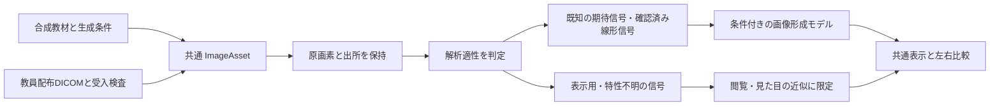

# 犬の胸部・腹部画像を用いる画質変化シミュレーション 設計案

案の版：v0.1／作成日：2026年11月7日（Asia/Tokyo）

**状態：設計提案のみ・未実装。第1段階の学術的な正式承認は引き続き保留。ひまりの査読と教員の判断を待つ。** この文書は機能追加や第2段階開始の承認を意味しない。既存アプリ、計算モデル、テスト、配布済みZIPは変更しない。

## 1. 提案の要点

既存の幾何学ファントム教材を残し、将来の独立した「犬の画像で学ぶ」画面を追加する。胸部・腹部の基準画像と、ノイズ・動きの影響を加えた画像を並べて表示する。

初回実装候補は、教員が解剖表現を確認した合成の犬教材画像による、仮想計数と動きの分離学習とする。教員配布の実画像は将来の別入力経路で受け入れ、その画像に元から含まれるノイズ・ぼけ・画像処理を保持した基準として扱う。現在、犬画像の選定・生成・読込・加工は行わない。

**一枚の処理済みX線画像を加工するだけで、別のkVpで撮影した真の像や、元画像より高い入射量で撮影した真の像を得られるとは扱わない。** スペクトル依存の画像形成には複数の物質の情報が関わるため、単一投影画像からのkVp変更は追加モデルなしでは一意に決まらない、という設計上の判断である。材質・スペクトル情報を使う方法は将来の研究課題とする。[Alvarez・Macovskiの原著](https://doi.org/10.1088/0031-9155/21/5/002)

| ご要望 | 設計案 | 初回候補の限界 |
| --- | --- | --- |
| 犬の胸部・腹部画像 | 部位・撮影方向・画像出所を持つ教材ライブラリー | 実画像未入手の間は合成と明示。解剖学的な正確さも教員確認を要する |
| kVp・mAs・撮影時間 | 仮想条件と連動するノイズ、時間と仮想運動に連動するぼけ | kVpによる組織コントラスト変化は、最初は再現しない |
| 元画像と変更画像の比較 | 左：読み込み基準画像／右：シミュレーション画像 | 左も表示処理を通した画像であり、保存画素値そのものとは区別 |
| ノイズと動きの個別操作 | 成分ごとのON/OFF、効果を単独に観察するモード | 実画像の既存ノイズ・ぼけは消去しない |
| 近似と検証済みの区別 | 画像の出所と変換の検証状態を別々に常時表示 | 現在の「物理検証済み」機能は0件 |
| 将来の教員DICOM | 入力アダプターと共通画像データ構造を分離 | DICOM読込・匿名化・定量解析は現時点では未実装 |

学生は実際のX線撮影を行わない。条件の操作はWebアプリ内の仮想撮影とし、実測画像を使う場合も教員から配布されたデータの解析に限る。

## 2. 学習対象と画像の役割

胸部では肺野内の細かな模様、心陰影・横隔膜・肋骨などの輪郭、腹部では臓器の境界や低コントラスト部分の見え方を観察対象の候補とする。具体的な注目領域と正しい解剖ラベルは、教員が画像ごとに確認する。病変診断の正誤判定や撮影条件の自動推奨は設けない。

| 画像の種類 | 用途 | 取り扱い |
| --- | --- | --- |
| 既存の合成幾何学パターン | 理論式、均一領域のノイズ、理論SNR | 第1段階のまま維持 |
| 犬を模した合成教材画像 | ノイズと動きが解剖的な見え方に及ぼす影響 | 「合成」「教育用近似」を表示。可能なら表示絵と別に既知の正の期待信号配列を用意 |
| 教員配布の犬胸部・腹部画像 | 実際の解剖画像を基準にした観察 | 「実測の基準画像」と「加工結果の妥当性」を混同しない |
| ステップウェッジ画像 | 減弱・信号・コントラスト評価、将来のROI課題 | 犬画像とは別の教材・解析対象 |
| 適切な専用エッジ画像 | 将来のESF・LSF・pre-sampling MTF測定 | 犬の臓器境界やステップウェッジを代用しない |

単なる犬のイラストや生成画像から信号配列を作る場合も、それは仮定した信号である。明るい画素をそのまま光子数に対応させて、実際の透過X線の量子ノイズを再現したとは説明しない。

## 3. 画面構成案

以下は画面の構成図であり、動作する試作画面ではない。

```text
既存の第1段階（4タブ）は維持  ｜  新規候補：犬の画像で学ぶ

部位 [胸部 / 腹部]  撮影方向 [教材ごとの選択肢]  基準画像 [教材ID]
出所：合成 / 教員配布実測       変換：教育用近似・未検証

仮想条件                         比較ビュー
 kVp                             ┌────────────────┬────────────────┐
 mAs                             │ 読み込み基準画像 │ シミュレーション │
 撮影時間（ms）                   │ 元の条件・出所   │ 変更した仮想条件 │
 固定条件 [mAs固定 / mA固定]       │                │ 適用した効果     │
 連動するmAまたはmAs              └────────────────┴────────────────┘
                                 同期ズーム・移動・表示窓
効果の分離                       現在の仮定・適用範囲を表示
 量子ノイズモデル [ON/OFF]
 仮想運動         [ON/OFF]         [条件を記録] [初期条件に戻す]
 速度・方向 / 追加粒状性           [ノイズ標本を再生成]
```

表示上の約束：

- 左右は同じ画像範囲、倍率、方向、表示窓を初期値とする。ウィンドウやズームは両側で同期し、片側だけの自動コントラスト調整は行わない。
- 原ファイルと原配列は不変とし、表示変換・シミュレーション結果は別に保持する。左右反転や回転を自動で行って撮影方向を変えない。
- 合成入力の「ノイズOFF」は期待信号表示。実画像の「OFF」は「追加ノイズOFF」であり、元のノイズがなくなる意味ではない。
- 記録には元画像の識別子・ハッシュ、出所、仮想条件、固定モード、運動・ノイズ設定、seed、表示窓、モデル版、検証範囲を保存する案とする。
- 元画像の実撮影条件と仮想条件を別欄に置く。変更した仮想値で元画像のDICOMタグを上書きしない。
- 条件比較時はseedを保持できるようにする。ただし異なる計数で同じseedを使っても、同一のノイズ模様になるとは説明しない。

## 4. kVp・mAs・撮影時間の連動

### 4.1 mAsと時間の整合

設計上の関係は `mAs = mA × t_s = mA × t_ms / 1000` とする。三つの値を矛盾したまま独立入力させない。[IAEA Human Health Series No.19](https://pub.iaea.org/MTCD/Publications/PDF/Pub1557_web.pdf)

| モード | 操作 | 自動的に変わる値 | 観察する内容 |
| --- | --- | --- | --- |
| mAs固定（初期候補） | 撮影時間 | mA = mAs / t_s | 仮想計数を保ったまま、時間と動きによるぼけを比較 |
| mA固定 | 撮影時間 | mAs = mA × t_s | ノイズと動きが同時に変わる条件を比較 |
| 効果分離 | 仮想計数または追加粒状性、仮想運動 | 撮影条件との連動を明示して解除 | 各成分の見え方だけを比較 |

「効果分離」は自由に画像効果を観察するモードであり、指定した撮影条件で実際に得られる結果を示さない。時間0、負値、非有限値は不可。連動結果が教員の定める教材入力範囲を外れた場合は、値を黙って切り詰めず理由を表示する。mA・時間の具体的な範囲は査読で決める。装置の管球負荷・焦点切替・実現可能性は、この教材の計算値から判定しない。

### 4.2 mAsの画像への反映

同一線質等を仮定した合成期待信号では、mAsに比例して仮想計数Nを変え、信号1の均一領域で相対量子ノイズ `1/√N` を学ぶ。表示窓と期待される明るさは揃える。デジタル画像の明るさを露出量そのものと結び付けない。[AAPM TG-116](https://pmc.ncbi.nlm.nih.gov/articles/PMC3908678/)

処理済み実画像ではmAs変更を真の露出変更と換算しない。参照条件に対する「追加粒状性の近似表示」とし、元画像のノイズより良い像を復元できるとは扱わない。

### 4.3 kVpの画像への反映

最初の候補では、kVp → 既存の簡易Kモデル → 仮想計数 → ノイズという経路だけを連動させる。犬画像の形と組織コントラストは固定し、「kVpによる線質・組織コントラストの変化は再現していません」と常時示す。計算値と犬画像の対応は仮定であり、画像の実測EIを予測したものではない。

**ガンマ・ウィンドウ・全体コントラストの調整を、別kVpの再撮影結果と呼ぶ案は採用しない。** 表示コントラストを学ぶ機能を設けるなら、kVpとは独立した表示設定にする。

kVpによる解剖学的コントラスト変化まで必要な場合は、材質・厚さ・線質等を備えた別の画像形成モデルを検討する必要がある。CT由来のDRRを用いた研究は参考になるが、人の研究結果を犬の教材へ検証なしに移植しない。これは承認後の別課題である。[Mooreほかの原著](https://pmc.ncbi.nlm.nih.gov/articles/PMC3473768/)

## 5. ノイズと動きの処理を分ける

### 5.1 既知の期待信号がある合成教材

正の期待信号をS、像上の一様並進速度をv、露出時間をtとする設計案：

```text
運動中の平均信号  S̄_t(x) = (1/t) ∫[0,t] S(x − vτ) dτ
仮想検出計数      C_i ~ Poisson(N × S̄_t,i)
規格化信号        I_i = C_i / N
表示画像          共通の表示変換(I_i)
```

これは「期待信号を動きで平均してから、検出時の確率的な計数を生成する」近似モデルである。撮影済みのノイズ画像全体を後から平滑化するモデルとは区別する。仮想運動を変えても独立に設定したNは変えないが、構造の境界では局所平均信号も変わるため、画像全域の局所SNRが不変とは説明しない。実検出器の相関ノイズ・DQEは別途検証が必要である。[動きとノイズの原著モデル](https://webpages.tuni.fi/foi/papers/Boracchi-Foi-Rectilinear_Blur-Noise_Trade-off-2010.pdf)

初回候補の運動は画面全体の等速並進だけとし、方向と速度を指定する。犬の呼吸、心拍、局所的・非剛体の運動を再現したものではない。画像端の扱いと有効比較範囲を明示し、折り返しによる偽の解剖像を発生させない設計とする。

尺度がない画像ではpx/sを使用する。mm/sを使う場合は、速度と画素間隔の参照面を一致させる。像面の速度なら `L_px = v_image × t_s / p_image` とする。被写体面の速度を検出器側の画素間隔で換算する場合には拡大率が別途必要である。同じ被写体面で校正された間隔を使える場合は `L_px = v_object × t_s / p_object` で直接換算する。非正方画素では行・列ごとに換算し、画面表示の拡大縮小はこの物理換算を変えない。[DICOM Pixel Spacing Calibration](https://dicom.nema.org/medical/dicom/current/output/chtml/part03/sect_10.7.html)

### 5.2 ノイズを含む犬の基準画像

既存画像への処理は次の二つを分ける。

| 経路 | できること | 制約 |
| --- | --- | --- |
| 見た目の教育用近似 | 追加粒状性と追加のぼけを個別にON/OFF・調節 | 元のノイズ・処理・ぼけは残る。元画像へのぼけは元のノイズも変えるため、量子ノイズを物理的に分離した表示とは呼ばない |
| 校正した画像変換（将来） | 確認した線形応答・ノイズ特性・条件範囲内での低入射量模擬 | 校正データ、既存ノイズの補正、NPS等の照合と検証記録が必要。未検証では利用不可 |

実画像に目標量のPoissonノイズをそのまま追加すると、元のノイズを二重に数える問題がある。例えば、同一線質・同一規格化・量子ノイズ優位等を仮定し、入射量比を0 < r ≤ 1とした単純モデルでは、追加分散は `σ_add² = σ_ref²(1/r − 1)` となる。これは分散の加算則からの設計用の導出であり、現在の犬画像に適用できると確認した式ではない。既存の低入射量模擬研究でも、raw信号と実測ノイズの対応や実測ファントムとの比較が行われている。[Veldkampほかの原著](https://pmc.ncbi.nlm.nih.gov/articles/PMC3043684/)

r > 1ではこの方法で必要な追加分散が負になるため、ノイズ追加で高入射量像を生成しない。元より高い入射量まで理論比較する場合は、既知の期待信号を持つ合成教材に切り替える。平滑化やAI補完を高入射量撮影の代替として使わない。

## 6. 「近似」と「物理検証済み」の表示

画像の出所と、変換処理の検証状態を独立に管理する。

| 表示項目 | 例 | 意味 |
| --- | --- | --- |
| 画像の出所 | 合成／教員配布実測 | 基準画像がどこから来たか |
| 解剖表現の確認 | 未確認／教員確認済み | 犬教材としての解剖表現の確認 |
| 変換の状態 | 教育用近似・未検証／指定条件内で物理検証済み | 加えた画像変化にどの根拠があるか |
| 適用範囲 | 対象装置、線質、入射量比、画素間隔、処理版等 | 検証結果を使える条件 |

物理検証済みの表示は、教員が確認した記録ID・方法・許容差・結果・適用範囲と結び付ける。利用者が任意に「検証済み」へ切り替える操作は設けない。入力が検証範囲を外れた場合はその機能を無効にし、未検証への変更を隠さない。数式の単体試験、解剖表現の確認、装置固有の物理検証、診断能評価はそれぞれ別の確認とする。

EI・DIは既存モデル由来の値と、将来の元画像に記録された装置値を別欄に置く。犬画像の明るさからEIを算出しない。SNRは当面、既存モデルの理論値として示す。犬画像のROIでは解剖構造の変動とランダムノイズを分ける必要があるため、単純な標準偏差をそのまま量子ノイズとして表示しない。CNR・MTF測定機能はこの追加表示案の初回実装には含めない。

## 7. 将来のDICOM読込構造

### 7.1 原画像・解析信号・表示画像の分離

次の構成を提案する。名称は設計上の候補で、ファイルやクラスを今回作成するものではない。



| 内部データ候補 | 保持する情報 |
| --- | --- |
| `ImageAsset` | 原画素、画像ID・ハッシュ、部位・方向、合成/実測、教員配布の識別子 |
| `SignalDescription` | 既知期待信号／確認済み線形信号／処理済み表示信号／不明、変換履歴、校正記録 |
| `Geometry` | 行・列の間隔、単位、基準面、元のタグ、校正状態 |
| `AcquisitionMetadata` | 元のkVp・mAs・時間・EI・EIₜ・DIと欠損状態。仮想条件と分離 |
| `DisplayState` | VOI、反転、表示窓、同期ズーム・移動。解析配列は変更しない |
| `SimulationRequest` | 仮想条件、固定モード、追加効果、seed、元画像ID、モデル版 |
| `SimulationResult` | 結果配列、適用効果、検証状態・適用範囲、制約メッセージ |

### 7.2 読込の初期対応範囲案

将来の読込初版は、教員が匿名化と内容を確認したPart 10形式の単画像DXを対象候補とする。For Presentation / For ProcessingのSOP Classで判別し、Modality文字列だけには依存しない。単一のモノクロ画像、8/16-bit unsigned、非圧縮Little Endianを初期候補とし、寸法・ビット設定・画素データ長等を検査する。CR・Secondary Capture・圧縮・Enhanced・マルチフレーム等は、実際に教員が配布するデータを確認して対応範囲を再判断する。非対応を黙って別形式や先頭フレームに置き換えない。[SOP Class一覧](https://dicom.nema.org/medical/dicom/current/output/chtml/part04/sect_B.5.html)、[ファイル形式](https://dicom.nema.org/medical/dicom/current/output/chtml/part10/chapter_7.html)

次の点を設計の受入条件にする。

- **For Processingだけでraw・線形・定量評価可能と判定しない。** 処理内容や校正情報の確認を別途必要とする。[DX Series Module](https://dicom.nema.org/medical/dicom/current/output/chtml/part03/sect_C.8.11.html)
- Pixel Intensity Relationship / Signと表示変換を混同しない。未知のLOG特性を推測で反転しない。DX固有のRescale制約も検査する。MONOCHROME1/2とPresentation LUT Shapeを合わせて扱い、二重反転を避ける。[DX Image Module](https://dicom.nema.org/medical/dicom/current/output/chtml/part03/sect_C.8.11.3.html)
- VOI LUTやWindow Center/Widthは表示用の設定として記録する。ウィンドウ処理済みの画素を将来の定量解析へそのまま渡さない。[VOI LUT Module](https://dicom.nema.org/medical/dicom/current/output/chtml/part03/sect_C.11.2.html)
- Pixel SpacingとImager Pixel Spacingを交換可能とみなさない。患者側の校正を含む間隔と、検出器筐体前面の画像間隔を区別し、基準面と行・列順序を保持する。尺度不明ならmmやcycles/mmへの換算を許可しない。[Pixel Spacing Calibration](https://dicom.nema.org/medical/dicom/current/output/chtml/part03/sect_10.7.html)、[DX Detector Module](https://dicom.nema.org/medical/dicom/current/output/chtml/part03/sect_C.8.11.4.html)
- EI `(0018,1411)`、EIₜ `(0018,1412)`、DI `(0018,1413)`は欠損し得る。欠損をゼロに置き換えず「不明」とする。元の記録値と、情報が揃った場合の再計算DIを区別し、元値は上書きしない。[Exposure Index Macro](https://dicom.nema.org/medical/dicom/current/output/chtml/part03/sect_10.19.html)
- 犬・飼い主の識別情報、画像内文字、オーバーレイ、私有属性等を含む匿名化確認を教員側の受入手順に含める。Patient Identity RemovedやBurned In Annotationだけを匿名化完了の保証としない。原画像は外部へ自動送信せず、利用者に全タグや識別情報を不用意に表示しない。[Patient Module](https://dicom.nema.org/medical/dicom/current/output/chtml/part03/sect_C.7.html)、[Confidentiality Profile](https://dicom.nema.org/medical/dicom/current/output/chtml/part15/sect_E.2.html)、[Clean Pixel Data](https://dicom.nema.org/medical/dicom/current/output/chtml/part15/sect_E.3.html)

LIN、既知の画素間隔、For Processingが揃っても、それだけで装置固有の物理検証済みとはしない。信号のオフセット、処理履歴、応答校正、解析対象の適合性も確認する。

DICOM由来の画像を加工しても、元のDICOMとして保存し直す機能は初回候補に含めない。保存するなら教育用の比較プレビューと設定・出所の記録に限り、DICOM派生画像の出力は別途仕様を決める。

## 8. 既存機能を維持する実装方針（承認後の候補）

- 現在の4タブ、計算式、係数、入力範囲、比較CSV、既存44試験を維持する。
- 犬画像の画面状態は既存の記録と別に保持する。犬画像の選択・リセットで既存比較記録を消さない。
- 数値モデルは既存の計算関数を呼び出すが、犬画像の画素と実測カーマとの対応が確認できない場合は「仮想モデル値」とする。
- 画像読込・信号変換・ノイズ・運動・表示を別モジュール候補として分離する。DICOMライブラリーの導入も実装承認後に行う。
- 元画像と同条件・同seed・同モデル版で結果を再現できるようにする。表示設定だけを変えても計算結果・原配列は変わらない構成とする。
- 画像が未登録・不適合・非対応でも、既存の幾何学ファントム教材は利用できるようにする。

## 9. 承認後に実施する受入試験案

以下は未実施の試験計画であり、合格済みの試験ではない。

| 試験 | 確認すること |
| --- | --- |
| 原本保護・比較 | 元画像・原タグが不変。左右の窓・倍率・方向が一致。効果OFFの意味が入力種別ごとに正しい |
| 合成量子ノイズ | 期待値、局所分散、固定seed、入射量4倍時の均一領域の相対ノイズ1/2 |
| 動きの分離 | 一様領域でノイズ量を固定しつつ構造をぼかせる。最終ノイズ画像への平滑化で代用していない |
| 時間の単位と連動 | ms/s、mA/mAsの整合。mAs固定とmA固定で変化する項目が異なる |
| 運動と幾何 | 速度0で追加ぼけなし、既知の一様並進長、非正方画素、画像端・表示リサイズの影響 |
| kVpの説明 | 入射量モデルの変化と、再現しない組織コントラストの区別が画面上で明確 |
| 実画像の限界 | 元のノイズを二重計上しない設計。高入射量像の生成や尺度を不明値から推測しない |
| DICOM表示 | SOP Classごとの対応、VOI、MONOCHROME反転、異常ビット設定、非対応入力、欠損タグ |
| DICOM受入 | 匿名化・画像内文字の確認、原本保持、識別情報の非表示、過大入力の制限 |
| 検証表示 | 近似・実測の出所・物理検証状態が別に見える。範囲外では検証済み表示を維持しない |
| 既存機能 | 元の44試験を回帰試験とし、犬画像の操作で既存計算・比較が変わらないことを追加確認 |

装置固有の「物理検証済み」へ移行するには、教員が利用可能な既存データや適切なファントムデータについて、平均–分散・NPS、信号応答、時間と運動、画像処理条件の対応を評価する。許容差と対象範囲は結果を見る前に定める。学生や動物に検証のための追加照射を求める設計にはしない。

## 10. 査読・教員判断が必要な点

1. 犬の合成教材と実画像の使い分け、胸部・腹部の撮影方向、観察する解剖構造。
2. 初回候補でkVpは仮想計数への影響に限定し、組織コントラストを固定する方針。
3. mAs固定・mA固定の操作方法、時間・仮想運動の教材上の範囲。
4. 処理済み実画像は見た目の近似に限定する表示と、高入射量への改善を生成しない制約。
5. 教員DICOMの実際の形式・匿名化・利用許可と、最初に対応する範囲。
6. 学術的説明、試験方法・許容差、実装開始の可否。

参照した物理・画像処理研究は主に人の撮影系や一般画像モデルであり、犬の撮影系に対する検証結果ではない。文献に基づく事実、そこからの設計上の推論、本アプリ固有の未検証の提案を区別して査読する。

**提出物はこの設計案のみ。犬画像機能・DICOM読込・CNR/MTF測定・画像生成や加工の本実装には進まない。**
